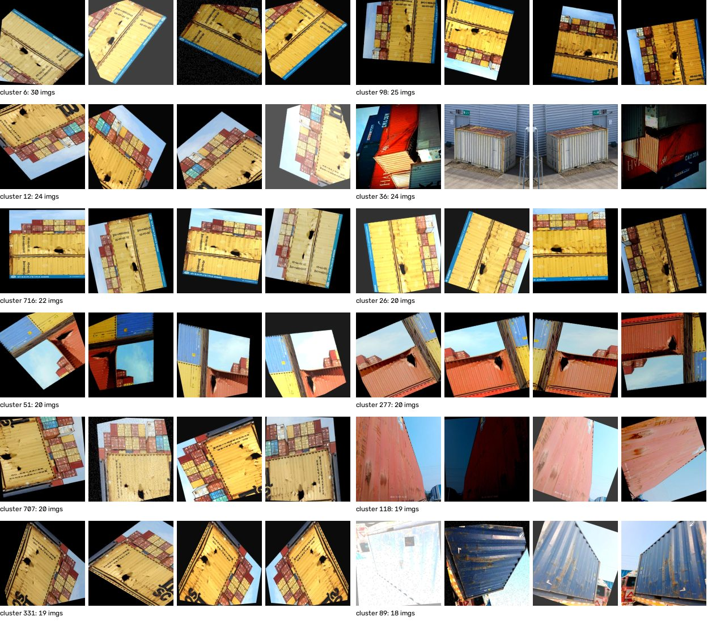
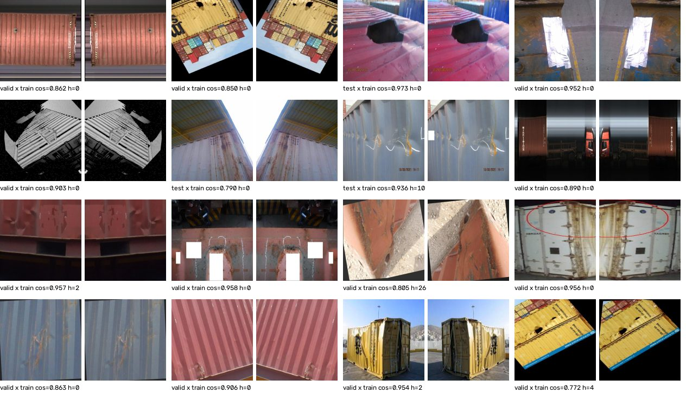
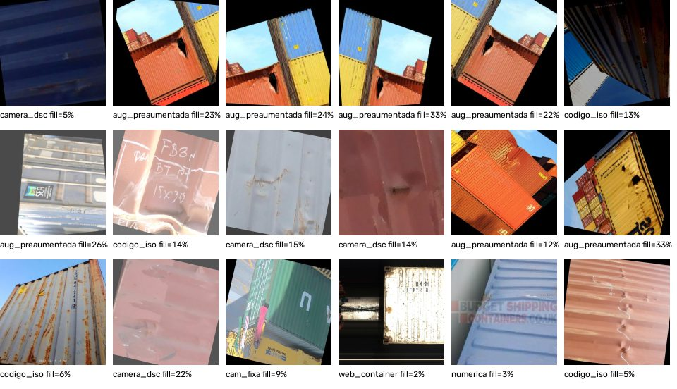
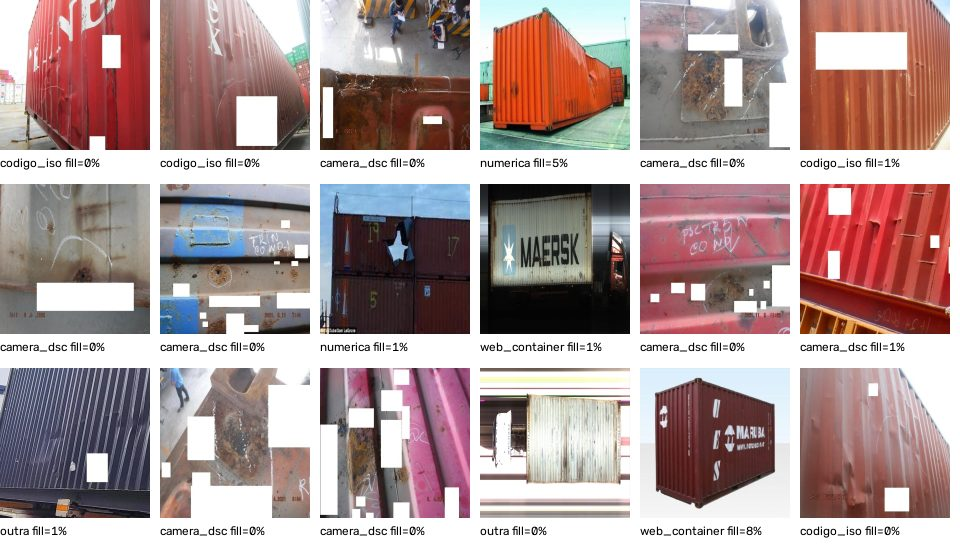
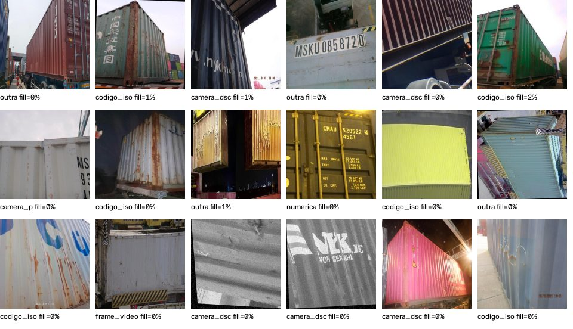
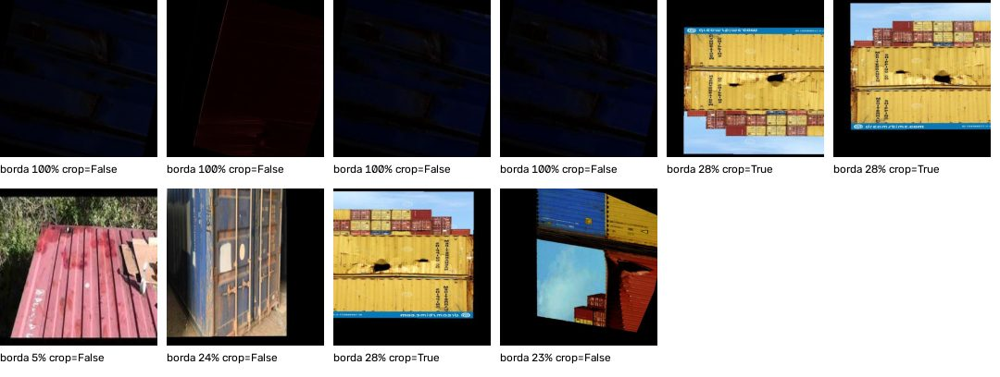
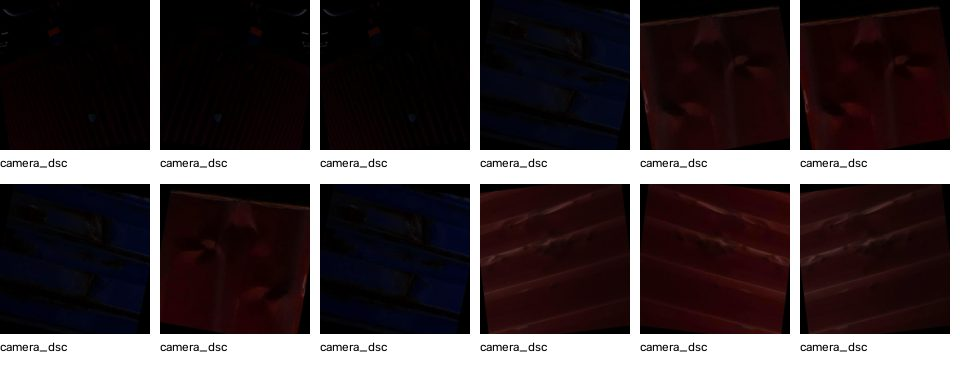
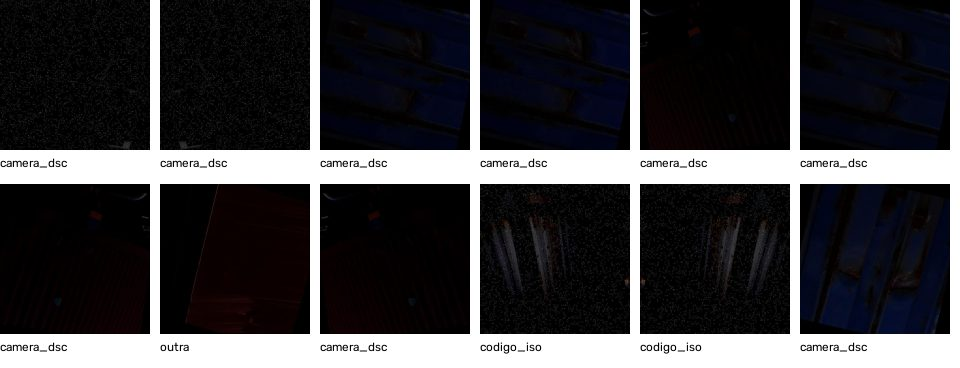
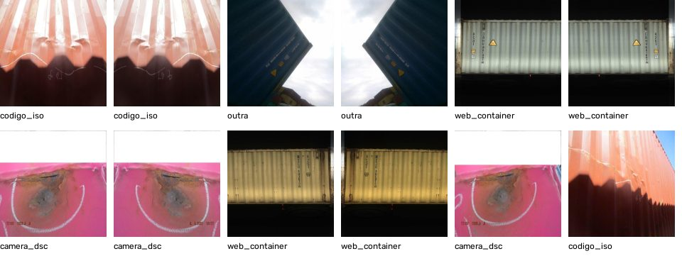

# Relatório de tratamento do dataset — 2026-11-18

Projeto Roboflow `giovanna-alcantara/container-damage-detection-lt-6ylwp` · pipeline v0.1.0 · commit `455de20679` · semente 42

Gerado automaticamente por `scripts/run_treatment.py` (etapas E1 a E6 do guia). Limiares são valores iniciais a calibrar.

## E1/E2 Inventário e integridade

- Imagens no manifesto: **5761**
- Dimensões mais comuns: 640×640 (5761)
- SHA-256 distintos: 5761 · nomes de origem distintos: 1845 · contêineres (ISO 6346) identificados: 130 (23% das imagens)

| integridade | n |
|---|---|
| ok | 5761 |

### Fontes inferidas pelo nome × split original

| source_id \ split_orig | test | train | valid | total |
|---|---|---|---|---|
| aug_preaumentada | 55 | 347 | 104 | 506 |
| cam_fixa | 18 | 167 | 58 | 243 |
| camera_dsc | 138 | 958 | 269 | 1365 |
| camera_img | 9 | 90 | 29 | 128 |
| camera_p | 11 | 128 | 41 | 180 |
| codigo_iso | 133 | 935 | 248 | 1316 |
| frame_video | 8 | 81 | 16 | 105 |
| numerica | 48 | 361 | 104 | 513 |
| outra | 130 | 809 | 242 | 1181 |
| web_container | 27 | 157 | 40 | 224 |
| total | 577 | 4033 | 1151 | 5761 |

### Anotações (caixas de avaria)

| split_orig | n_caixas | n_rust | n_dent | n_hole |
|---|---|---|---|---|
| test | 1357 | 743 | 486 | 128 |
| train | 9877 | 5808 | 3238 | 831 |
| valid | 2737 | 1502 | 1004 | 231 |

- Imagens sem nenhuma caixa: 0

## E3 Duplicatas e grupos

Regra: SHA-256 idêntico, **ou** mesma foto de origem (nome sem sufixos do Roboflow **e** cosseno bruto ≥ 0.8), **ou** pHash ≤ 6 (invariante a flip) **e** cosseno ≥ 0.95 (embeddings do Roboflow, centralizados). `group_id` une ainda todo o nome de origem e o mesmo código de contêiner (conservador para o split).

- Cópias exatas extras (SHA-256): **0**
- Pares pHash: 3546 · pares cosseno: 458 · ambos: 450
- Nomes de origem distintos: **1845**
- Clusters de duplicatas: **1949** para 5761 imagens → **66.2% redundantes**; maior cluster: 30
- Grupos (cluster + contêiner): 1644; maior grupo: 63

Redundância por fonte:

| source_id | imagens | clusters | frac_redundante |
|---|---|---|---|
| aug_preaumentada | 506 | 67 | 0.868 |
| cam_fixa | 243 | 56 | 0.77 |
| camera_dsc | 1365 | 508 | 0.628 |
| camera_img | 128 | 54 | 0.578 |
| camera_p | 180 | 96 | 0.467 |
| codigo_iso | 1316 | 368 | 0.72 |
| frame_video | 105 | 24 | 0.771 |
| numerica | 513 | 113 | 0.78 |
| outra | 1181 | 543 | 0.54 |
| web_container | 224 | 120 | 0.464 |

## E5 Auditoria do split original do Roboflow

Chaves que aparecem em mais de um split (vazamento por grupo):

| chave | grupos | imagens |
|---|---|---|
| sha256 | 0 | 0 |
| nome_origem | 889 | 3960 |
| dup_cluster_id | 909 | 3833 |
| container_code | 104 | 1239 |
| group_id | 803 | 4197 |

Vizinho mais próximo no treino acima do limiar de quase duplicata:

| split | n | de | frac | mesma_foto_origem | identicas_sha |
|---|---|---|---|---|---|
| valid | 109 | 1151 | 0.0947 | 820 | 0 |
| test | 58 | 577 | 0.101 | 391 | 0 |

### Novo split agrupado (StratifiedGroupKFold)

6 folds; fold 0 = teste fixo. Nenhum `group_id`, `dup_cluster_id` ou SHA-256 atravessa folds (verificado por `split.check_no_leak`).

| split_orig \ split_novo | dev | teste_fixo | total |
|---|---|---|---|
| test | 489 | 88 | 577 |
| train | 3359 | 674 | 4033 |
| valid | 953 | 198 | 1151 |
| total | 4801 | 960 | 5761 |

## Artefatos de augmentation já embutidos no dataset

O dataset foi exportado de outra versão do Roboflow com augmentation e reimportado: os nomes trazem `.rf.<hash>` e cada foto de origem aparece várias vezes. Para a planificação isso é crítico, porque rotação, cisalhamento e perspectiva **artificiais** mudam justamente a geometria que se quer estimar, e o preenchimento (preto ou cinza constante) não é uma borda retangular.

- `aug_geometrica` (preenchimento constante não retangular ligado a canto/borda): **2261** imagens (39.2%)
- `cutout` (retângulos de cor constante colados): **269** imagens (4.7%)
- Imagens sem nenhum dos dois artefatos: **3294** (57.2%)
- Fotos de origem (nomes) com pelo menos uma cópia limpa: 1473 de 1845

| source_id | n | aug_geometrica | cutout | fill_frac_med |
|---|---|---|---|---|
| aug_preaumentada | 506 | 0.887 | 0.00198 | 0.27 |
| cam_fixa | 243 | 0.407 | 0.00412 | 0.00919 |
| camera_dsc | 1365 | 0.351 | 0.0974 | 0.00831 |
| camera_img | 128 | 0.203 | 0.0312 | 0 |
| camera_p | 180 | 0.122 | 0.00556 | 0 |
| codigo_iso | 1316 | 0.382 | 0.0137 | 0.00837 |
| frame_video | 105 | 0.438 | 0 | 0.00843 |
| numerica | 513 | 0.427 | 0.0585 | 0.016 |
| outra | 1181 | 0.227 | 0.0364 | 0 |
| web_container | 224 | 0.67 | 0.17 | 0.0586 |

| split_orig | n | aug_geometrica | cutout |
|---|---|---|---|
| test | 577 | 0.395 | 0.0537 |
| train | 4033 | 0.389 | 0.0484 |
| valid | 1151 | 0.404 | 0.0374 |

**aug_geometrica**

**cutout**

**limpas**

## E4 Caracterização

Medianas por split original (só região de conteúdo):

| split_orig | aug_geometrica | cutout_n | fill_frac | blur_score | noise_sigma | bw_efetiva | jpeg_quality_est | lum_mean | faixa_dinamica | clip_frac | color_cast | border_frac | caixa_area_max | st_coerencia | corr_pico | paralelismo |
|---|---|---|---|---|---|---|---|---|---|---|---|---|---|---|---|---|
| test | 0 | 0 | 0.0109 | 212 | 0.631 | 0.0557 | 74.8 | 119 | 204 | 0.00908 | 0.156 | 0 | 0.0623 | 0.257 | 0.331 | 0.635 |
| train | 0 | 0 | 0.00932 | 211 | 0.64 | 0.0584 | 74.8 | 117 | 199 | 0.00739 | 0.135 | 0 | 0.0634 | 0.262 | 0.326 | 0.634 |
| valid | 0 | 0 | 0.0103 | 201 | 0.625 | 0.0601 | 74.8 | 116 | 196 | 0.00707 | 0.139 | 0 | 0.0643 | 0.251 | 0.327 | 0.646 |

Medianas por fonte:

| source_id | aug_geometrica | cutout_n | fill_frac | blur_score | noise_sigma | bw_efetiva | jpeg_quality_est | lum_mean | faixa_dinamica | clip_frac | color_cast | border_frac | caixa_area_max | st_coerencia | corr_pico | paralelismo |
|---|---|---|---|---|---|---|---|---|---|---|---|---|---|---|---|---|
| aug_preaumentada | 1 | 0 | 0.27 | 196 | 0.561 | 0.0415 | 74.8 | 139 | 218 | 0.0086 | 0.199 | 0 | 0.0359 | 0.257 | 0.368 | 0.599 |
| cam_fixa | 0 | 0 | 0.00919 | 818 | 2.22 | 0.114 | 74.8 | 102 | 182 | 0.00258 | 0.0362 | 0 | 0.02 | 0.139 | 0.342 | 0.471 |
| camera_dsc | 0 | 0 | 0.00831 | 98.4 | 0.479 | 0.0549 | 74.8 | 110 | 179 | 0.00433 | 0.215 | 0 | 0.0855 | 0.301 | 0.368 | 0.681 |
| camera_img | 0 | 0 | 0 | 286 | 0.728 | 0.0933 | 74.8 | 121 | 207 | 0.00182 | 0.086 | 0 | 0.0631 | 0.502 | 0.279 | 0.767 |
| camera_p | 0 | 0 | 0 | 134 | 0.505 | 0.0496 | 74.8 | 122 | 194 | 0.0016 | 0.0787 | 0 | 0.0548 | 0.27 | 0.35 | 0.602 |
| codigo_iso | 0 | 0 | 0.00837 | 186 | 0.606 | 0.0514 | 74.8 | 127 | 190 | 0.0159 | 0.137 | 0 | 0.126 | 0.301 | 0.305 | 0.658 |
| frame_video | 0 | 0 | 0.00843 | 605 | 1.86 | 0.118 | 74.8 | 105 | 194 | 0.00172 | 0.0248 | 0 | 0.0366 | 0.167 | 0.291 | 0.431 |
| numerica | 0 | 0 | 0.016 | 374 | 1.01 | 0.0794 | 74.8 | 121 | 212 | 0.0184 | 0.124 | 0 | 0.0797 | 0.183 | 0.311 | 0.631 |
| outra | 0 | 0 | 0 | 284 | 0.797 | 0.0657 | 74.8 | 112 | 204 | 0.00362 | 0.132 | 0 | 0.0419 | 0.268 | 0.333 | 0.612 |
| web_container | 1 | 0 | 0.0586 | 375 | 0.629 | 0.0436 | 74.8 | 90 | 241 | 0.0094 | 0.104 | 0 | 0.0146 | 0.209 | 0.289 | 0.737 |

### Bordas pretas e colagens

- Com borda preta detectada: **17** (0.3%); `safe_to_crop`: 5
- Borda escura gradual (conteúdo real, não recortar): 488
- Possíveis colagens (faixa preta no meio): 0
- Flags: nenhuma=5761

Bordas por lado (imagens com borda > 0):

| lado | n | mediana_frac |
|---|---|---|
| top | 9 | 0.172 |
| bottom | 8 | 0.586 |
| left | 9 | 0.231 |
| right | 7 | 0.237 |

Extremos:   

## E6 Amostra para rotulagem

`amostra_rotulagem.csv`: **800** representantes de cluster, fora do teste fixo; 240 aleatórias e 560 estratificadas (fonte × nitidez × área da caixa). As primeiras 100 linhas marcadas em `calibracao_kappa` são a rodada de calibração com 2 anotadores (seção 2.6).

| source_id | n |
|---|---|
| outra | 195 |
| camera_dsc | 172 |
| codigo_iso | 160 |
| numerica | 73 |
| camera_p | 68 |
| cam_fixa | 39 |
| camera_img | 32 |
| web_container | 26 |
| frame_video | 21 |
| aug_preaumentada | 14 |

`pares_revisao_dedup.csv`: pares por faixa de cosseno para julgar à mão e calibrar o limiar (E3.3).
