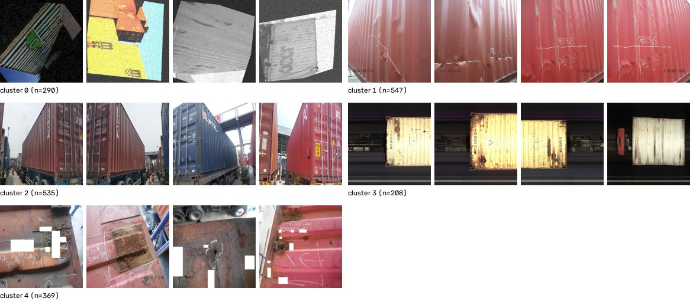
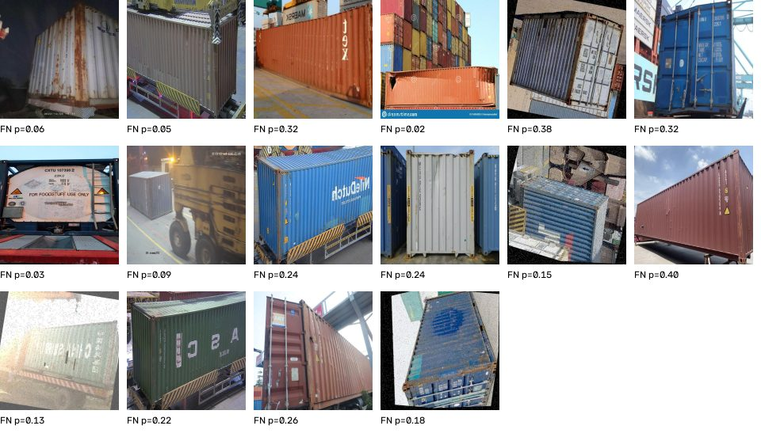
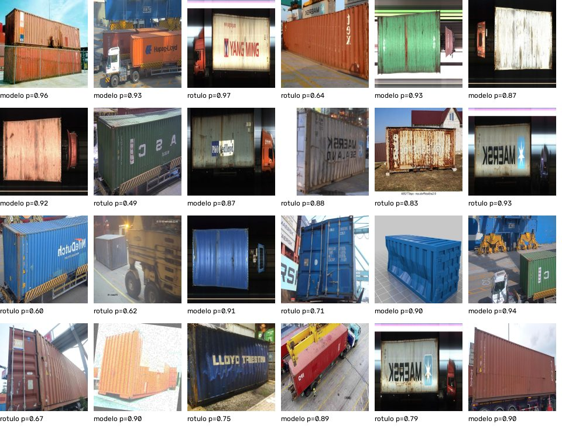
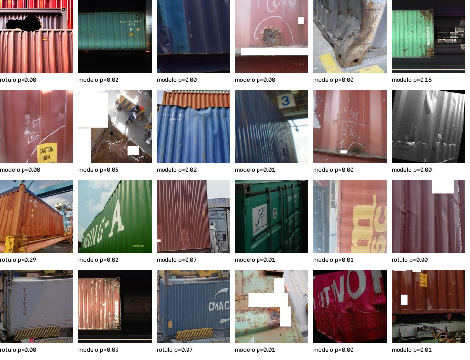
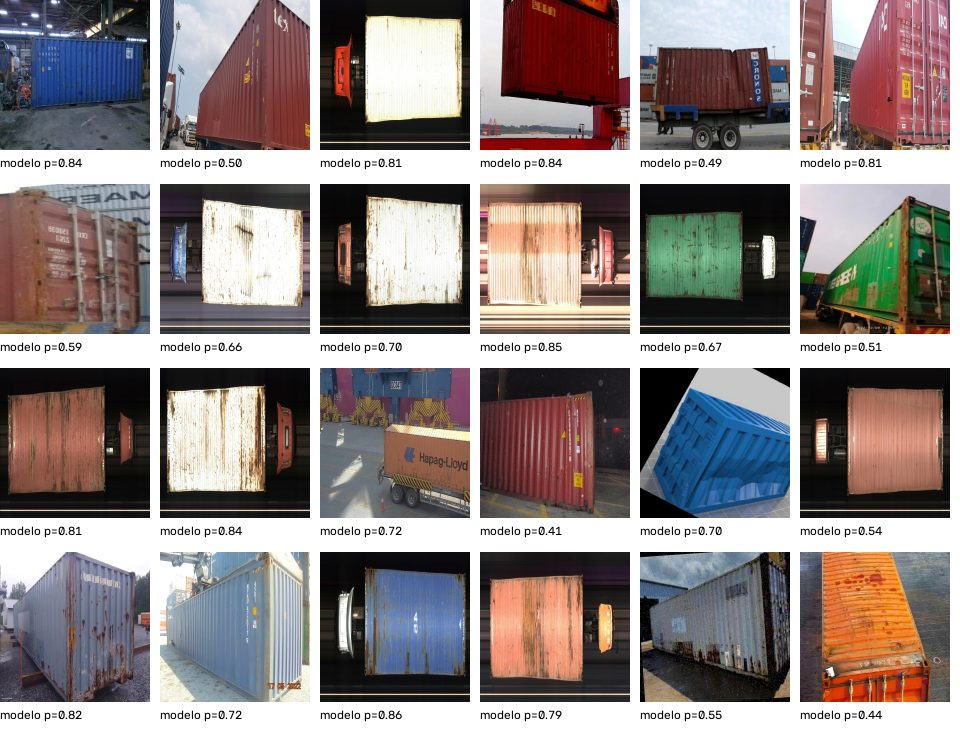

# Relatório — divisão em sem zoom e com zoom (2026-11-18)

Gerado por `scripts/run_zoom.py` + `scripts/report_zoom.py` · commit `2d6457406c` · semente 42 · manifesto `run_2026-11-18`. Seção 16 do guia (S0 a S10).

> **Rótulos provisórios.** Os rótulos de zoom desta execução foram feitos por anotador automático (Claude, inspeção visual) seguindo `docs/guia_anotacao_zoom.md`. Servem para validar o pipeline; a anotação humana (2 anotadores, κ, adjudicação) substitui `labels/zoom_rotulos.csv` sem mudar o código.

## S0 Pré-requisitos

- Manifesto: 5761 imagens → dataset único: **1949 representantes** (teste fixo: 323). Invariantes D8 verificados.
- Motivo da escolha do representante: copia_limpa_mais_nitida = 1281, sem_copia_limpa_mais_nitida = 334, foto_unica = 239, foto_unica_com_artefato = 95

## S1 Exploração sem rótulos

Proxies das caixas de avaria (só para explorar e estratificar; não entram no modelo).

Teste de dip de Hartigan sobre log10 da área da maior caixa (p pequeno = mais de um pico):

| grupo | n | dip | p | por | q_bh |
|---|---|---|---|---|---|
| aug_preaumentada | 67 | 0.0358 | 0.8 | fonte | 0.996 |
| cam_fixa | 56 | 0.0333 | 0.953 | fonte | 0.996 |
| camera_dsc | 508 | 0.012 | 0.942 | fonte | 0.996 |
| camera_img | 54 | 0.05 | 0.393 | fonte | 0.996 |
| camera_p | 96 | 0.0247 | 0.973 | fonte | 0.996 |
| codigo_iso | 368 | 0.0132 | 0.969 | fonte | 0.996 |
| numerica | 113 | 0.0275 | 0.829 | fonte | 0.996 |
| outra | 543 | 0.0131 | 0.822 | fonte | 0.996 |
| web_container | 120 | 0.0173 | 0.996 | fonte | 0.996 |
| TODOS | 1949 | 0.00664 | 0.886 | fonte | 0.996 |
| dent | 1084 | 0.00882 | 0.89 | classe | 0.996 |
| hole | 192 | 0.0159 | 0.992 | classe | 0.996 |
| rust | 673 | 0.0102 | 0.957 | classe | 0.996 |
| TODOS | 1949 | 0.00664 | 0.886 | classe | 0.996 |

k-means no embedding DINOv2 (média dos patches, 448): melhor k = 5 pela silhueta.

| k | silhueta | inercia |
|---|---|---|
| 3 | 0.108 | 1.6e+03 |
| 4 | 0.118 | 1.5e+03 |
| 5 | 0.13 | 1.43e+03 |
| 6 | 0.126 | 1.38e+03 |

## S4 Confiabilidade dos rótulos

- Reteste às cegas de 100 imagens (mesmo anotador, outra ordem): concordância 97%, κ ponderado 0.95, κ binário (Z0 × resto) 0.96. **É consistência intra-anotador, não κ entre anotadores.**
- Variação por augmentation: em 3 de 30 clusters as cópias receberam zoom diferente; em 2 a decisão Z0 mudou.

| principal | Z0 | Z1 | Z2 |
|---|---|---|---|
| Z0 | 15 | 1 | 0 |
| Z1 | 0 | 59 | 0 |
| Z2 | 0 | 2 | 23 |

## S5 Análise dos rótulos

- Rotuladas: 560 (IND = 4); distribuição: {'Z1': 360, 'Z2': 121, 'Z0': 75}
- Prevalência de Z0 na amostra aleatória: **0.13 (IC 95% 0.08–0.21)**; em todas as rotuladas: 0.13 (IC 95% 0.11–0.17)

| variavel | grupo | n | Z0 | Z1 | Z2 | prev_Z0 | ic_lo | ic_hi |
|---|---|---|---|---|---|---|---|---|
| source_id | aug_preaumentada | 39 | 5 | 34 | 0 | 0.128 | 0.056 | 0.267 |
| source_id | cam_fixa | 30 | 5 | 25 | 0 | 0.167 | 0.0734 | 0.336 |
| source_id | camera_dsc | 120 | 4 | 57 | 59 | 0.0333 | 0.013 | 0.0826 |
| source_id | camera_img | 32 | 4 | 22 | 6 | 0.125 | 0.0497 | 0.281 |
| source_id | camera_p | 40 | 10 | 27 | 3 | 0.25 | 0.142 | 0.402 |
| source_id | codigo_iso | 77 | 2 | 38 | 37 | 0.026 | 0.00715 | 0.0898 |
| source_id | frame_video | 16 | 2 | 14 | 0 | 0.125 | 0.035 | 0.36 |
| source_id | numerica | 38 | 14 | 19 | 5 | 0.368 | 0.234 | 0.527 |
| source_id | outra | 126 | 16 | 99 | 11 | 0.127 | 0.0797 | 0.196 |
| source_id | web_container | 38 | 13 | 25 | 0 | 0.342 | 0.212 | 0.501 |
| classe_principal | dent | 317 | 37 | 193 | 87 | 0.117 | 0.0859 | 0.157 |
| classe_principal | hole | 62 | 8 | 51 | 3 | 0.129 | 0.0669 | 0.234 |
| classe_principal | rust | 177 | 30 | 116 | 31 | 0.169 | 0.121 | 0.232 |
| artefato_aug | False | 444 | 60 | 280 | 104 | 0.135 | 0.106 | 0.17 |
| artefato_aug | True | 112 | 15 | 80 | 17 | 0.134 | 0.0829 | 0.209 |

Associação com o zoom (V de Cramér, informação mútua, q de Benjamini-Hochberg):

| variavel | cramers_v | p | info_mutua_bits | q_bh |
|---|---|---|---|---|
| source_id | 0.396 | 1.09e-27 | 0.242 | 3.27e-27 |
| classe_principal | 0.135 | 0.000421 | 0.0307 | 0.000631 |
| artefato_aug | 0.0822 | 0.152 | 0.00518 | 0.183 |
| split_orig | 0.0432 | 0.722 | 0.00252 | 0.722 |
| t_proxy | 0.216 | 1.62e-10 | 0.0674 | 3.24e-10 |
| cluster_emb | 0.418 | 8.43e-38 | 0.316 | 5.06e-37 |

## S6 Modelagem — matriz de experimentos

LR (L2, `class_weight` balanceado) com C e Platt ajustados em CV interno agrupado; CV externa agrupada 5 folds × 5 repetições em `dev`. PR-AUC com IC por bootstrap de grupos.

| exp | modelo | pr_auc_media | pr_auc_dp_repeticoes | roc_auc | bal_acc | ece | brier | pr_auc_ic_lo | pr_auc_ic_hi |
|---|---|---|---|---|---|---|---|---|---|
| Z3a_dino_cls_224_svm | SVM+Platt | 0.788 | 0.0286 | 0.946 | 0.805 | 0.0212 | 0.0567 | 0.723 | 0.898 |
| Z3a_dino_cls_224 | LR+Platt | 0.78 | 0.0217 | 0.947 | 0.796 | 0.0229 | 0.06 | 0.705 | 0.883 |
| Z6_dino_concat_opencv | LR+Platt | 0.748 | 0.0272 | 0.95 | 0.794 | 0.0218 | 0.0625 | 0.662 | 0.87 |
| Z4b_dino_concat_448 | LR+Platt | 0.742 | 0.0226 | 0.949 | 0.792 | 0.0285 | 0.0632 | 0.652 | 0.867 |
| Z4a_dino_media_448 | LR+Platt | 0.739 | 0.0307 | 0.948 | 0.771 | 0.0204 | 0.0649 | 0.659 | 0.86 |
| Z3b_dino_cls_448 | LR+Platt | 0.708 | 0.0278 | 0.939 | 0.779 | 0.0312 | 0.067 | 0.623 | 0.84 |
| Z5_opencv | LR+Platt | 0.323 | 0.0222 | 0.742 | 0.507 | 0.0362 | 0.117 | 0.239 | 0.446 |
| Z2b_trivial_metadados_fonte | LR+Platt | 0.263 | 0.0218 | 0.649 | 0.5 | 0.0109 | 0.123 | 0.189 | 0.371 |
| Z2a_so_fonte | LR+Platt | 0.239 | 0.00873 | 0.632 | 0.5 | 0.028 | 0.124 | 0.167 | 0.308 |
| Z2_majoritaria | maj | 0.15 | 0 | 0.487 | 0.5 | 1.78e-06 | 0.128 | 0.112 | 0.194 |

Modelo escolhido: **Z3a_dino_cls_224**. Diferença pareada de PR-AUC (bootstrap por grupo):

| contra | dif_pr_auc | ic_lo | ic_hi | exclui_zero |
|---|---|---|---|---|
| Z2_majoritaria | 0.653 | 0.562 | 0.732 | True |
| Z2a_so_fonte | 0.576 | 0.471 | 0.658 | True |
| Z2b_trivial_metadados_fonte | 0.535 | 0.416 | 0.625 | True |

## S7 Avaliação

Limiares (fora-da-amostra, precisão-alvo 0,95): τ_alto = 0.861, τ_baixo = 0.406. Entre os dois → revisão.

- Dev (OOF): A = 15 imagens, precisão 1.00 (IC 95% 0.80–1.00), cobertura de Z0 25%, abstenção 12%; precisão de B 0.95 (IC 95% 0.92–0.97)
- **Teste fixo** (n = 158, Z0 = 15): PR-AUC 0.74 (IC 0.50–0.90), ROC-AUC 0.93, ECE 0.039; A = 5 imagens, precisão 1.00 (IC 95% 0.57–1.00), cobertura de Z0 33%
- Cabeça ordinal (Z0/Z1/Z2): κ ponderado 0.69, acurácia 81%

| rotulo | Z0 | Z1 | Z2 |
|---|---|---|---|
| Z0 | 44 | 16 | 0 |
| Z1 | 22 | 204 | 28 |
| Z2 | 0 | 11 | 73 |

### Critérios de aceite

| criterio | valor | limite | passou |
|---|---|---|---|
| Precisão de A (limite inferior do IC, teste fixo) >= 0,90 | 0.566 | 0.9 | False |
| κ ponderado modelo × rótulo (ordinal, dev) >= 0,6 | 0.69 | 0.6 | True |
| ECE (teste fixo) <= 0,05 | 0.0388 | 0.05 | True |
| Precisão de A >= 0,85 em cada fonte com n >= 30 | 1 | 0.85 | True |
| Ganho sobre o trivial (IC pareado exclui zero) | 0.416 | 0 | True |
| Ganho sobre o só-fonte (IC pareado exclui zero) | 0.471 | 0 | True |

### Leave-one-source-out

| fonte | n | n_Z0 | pr_auc | pr_auc_cv | A_n | A_precisao |
|---|---|---|---|---|---|---|
| outra | 78 | 11 | 0.888 | 0.94 | 4 | 1 |
| aug_preaumentada | 30 | 4 | 0.804 | 0.5 | 0 |  |
| cam_fixa | 26 | 4 | 0.875 | 0.741 | 0 |  |
| camera_img | 28 | 3 | 0.6 | 0.681 | 1 | 1 |
| camera_dsc | 77 | 4 | 1 | 1 | 2 | 1 |
| camera_p | 33 | 8 | 0.604 | 0.598 | 2 | 0.5 |
| codigo_iso | 50 | 1 | 0.125 | 0.167 | 0 |  |
| web_container | 27 | 10 | 0.842 | 0.895 | 3 | 1 |
| numerica | 34 | 13 | 0.943 | 0.94 | 2 | 1 |
| frame_video | 15 | 2 | 0.417 | 0.325 | 0 |  |

### Curva de aprendizado

| n_rotuladas | pr_auc_media | pr_auc_dp | n_reps |
|---|---|---|---|
| 100 | 0.628 | 0.0788 | 3 |
| 200 | 0.694 | 0.118 | 3 |
| 300 | 0.8 | 0.0569 | 3 |
| 398 | 0.765 | 0.0144 | 3 |

### Robustez a corrupções (teste fixo)

| corrupcao | pr_auc | A_n | A_precisao | queda_pr_auc |
|---|---|---|---|---|
| original | 0.735 | 4 | 1 | 0 |
| desfoque | 0.737 | 7 | 0.857 | -0.00248 |
| ruido | 0.692 | 3 | 1 | 0.0427 |
| jpeg_q20 | 0.758 | 4 | 1 | -0.0226 |
| escuro_x0.5 | 0.75 | 5 | 1 | -0.0151 |

### Fatias

| fatia | grupo | n | n_Z0 | pr_auc | A_n | A_precisao |
|---|---|---|---|---|---|---|
| source_id | aug_preaumentada | 30 | 4 | 0.5 | 0 |  |
| source_id | cam_fixa | 26 | 4 | 0.741 | 0 |  |
| source_id | camera_dsc | 77 | 4 | 1 | 2 | 1 |
| source_id | camera_img | 28 | 3 | 0.681 | 1 | 1 |
| source_id | camera_p | 33 | 8 | 0.598 | 0 |  |
| source_id | codigo_iso | 50 | 1 | 0.167 | 0 |  |
| source_id | frame_video | 15 | 2 | 0.325 | 0 |  |
| source_id | numerica | 34 | 13 | 0.94 | 4 | 1 |
| source_id | outra | 78 | 11 | 0.94 | 4 | 1 |
| source_id | web_container | 27 | 10 | 0.895 | 4 | 1 |
| artefato_aug | False | 318 | 49 | 0.819 | 13 | 1 |
| artefato_aug | True | 80 | 11 | 0.737 | 2 | 1 |
| t_nitidez | alta | 133 | 27 | 0.818 | 9 | 1 |
| t_nitidez | baixa | 133 | 15 | 0.777 | 2 | 1 |
| t_nitidez | media | 132 | 18 | 0.821 | 4 | 1 |
| classe_principal | dent | 231 | 30 | 0.789 | 6 | 1 |
| classe_principal | hole | 46 | 6 | 0.733 | 1 | 1 |
| classe_principal | rust | 121 | 24 | 0.853 | 8 | 1 |

### Erros (dev, OOF): 0 falsos positivos de A, 16 falsos negativos, 46 abstenções

## S8 Roteamento — os três conjuntos

Rótulo manual quando existe; senão o modelo. Cópias recebem o destino do representante só para rastreio.

| dataset | n | origem_rotulo | origem_modelo | split_dev | split_teste_fixo |
|---|---|---|---|---|---|
| sem_zoom | 137 | 75 | 62 | 116 | 21 |
| com_zoom | 1674 | 481 | 1193 | 1396 | 278 |
| revisao | 138 | 4 | 134 | 114 | 24 |

Cópias propagadas (rastreio): {'com_zoom': 5054, 'sem_zoom': 354, 'revisao': 353}

**Sem zoom**

**Com zoom**

**Revisão**

## S9 Comparação dos dois datasets

| variavel | tipo | estatistica | valor | p | sem_zoom | com_zoom | q_bh |
|---|---|---|---|---|---|---|---|
| source_id | categorica | V de Cramér | 0.314 | 1.25e-33 |  |  | 1.5e-32 |
| classe_principal | categorica | V de Cramér | 0.0745 | 0.00656 |  |  | 0.00875 |
| tem_rust | categorica | V de Cramér | 0.0741 | 0.00161 | 0.46 | 0.327 | 0.00277 |
| tem_dent | categorica | V de Cramér | 0.0694 | 0.00313 | 0.453 | 0.582 | 0.0047 |
| tem_hole | categorica | V de Cramér | 0.0133 | 0.572 | 0.117 | 0.102 | 0.572 |
| caixa_area_max | continua | delta de Cliff (A vs B) | -0.51 | 5.62e-21 | 0.0134 | 0.0643 | 3.37e-20 |
| blur_score | continua | delta de Cliff (A vs B) | 0.366 | 7.32e-16 | 384 | 213 | 2.93e-15 |
| noise_sigma | continua | delta de Cliff (A vs B) | 0.214 | 2.87e-05 | 0.863 | 0.649 | 6.89e-05 |
| lum_mean | continua | delta de Cliff (A vs B) | -0.0842 | 0.0478 | 116 | 117 | 0.0573 |
| faixa_dinamica | continua | delta de Cliff (A vs B) | 0.194 | 3.56e-05 | 220 | 202 | 7.12e-05 |
| color_cast | continua | delta de Cliff (A vs B) | -0.229 | 3.38e-07 | 0.0934 | 0.143 | 1.01e-06 |
| bw_efetiva | continua | delta de Cliff (A vs B) | 0.0472 | 0.259 | 0.0631 | 0.0564 | 0.283 |

| source_id | com_zoom | sem_zoom |
|---|---|---|
| aug_preaumentada | 60 | 5 |
| cam_fixa | 41 | 9 |
| camera_dsc | 491 | 8 |
| camera_img | 48 | 5 |
| camera_p | 75 | 11 |
| codigo_iso | 357 | 2 |
| frame_video | 21 | 2 |
| numerica | 73 | 23 |
| outra | 439 | 41 |
| web_container | 69 | 31 |
